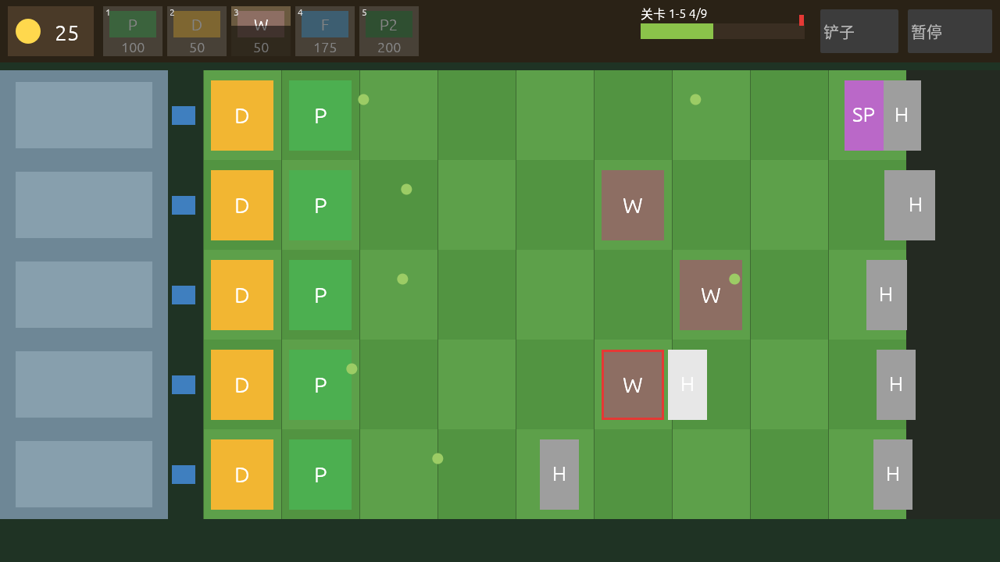
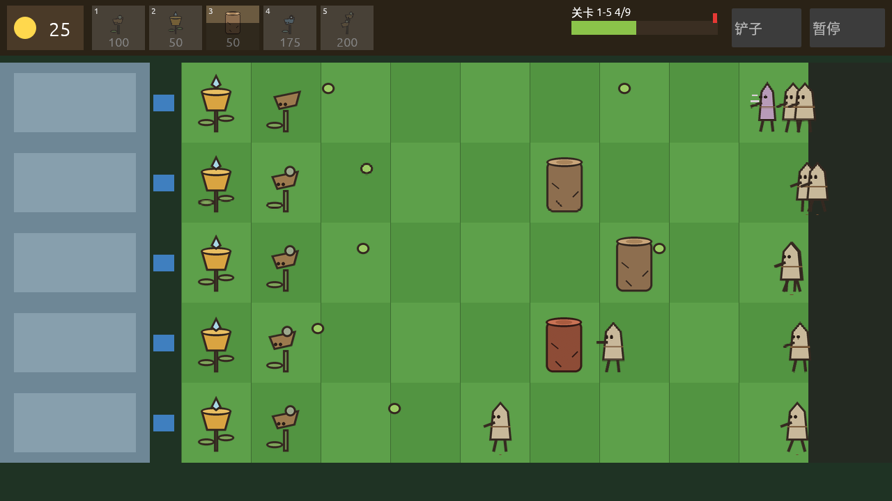

# Rootguard

原创车道式植物塔防游戏，基于 Trellia 引擎（https://github.com/CIPFZ/trellia）。在 5 行 × 9 列的花园里放置防御植物，
收集 Dew、搭配卡组，抵御从右侧涌来的枯壳怪（Husk），守住左侧的温室。Phase 1 包含白天花园、12 种防御者、
8 种敌人（+1 种衍生）与 10 关冒险模式，界面支持简体中文与英文。

| 占位模式（默认） | 皮肤模式 |
|---|---|
|  |  |

截图为关卡 1-5 脚本解回放约 150 秒时的同一时刻，由 `scripts/screenshot.sh` 在 Xvfb 虚拟显示中生成。

## 安装

从 GitHub Releases 下载对应平台的安装包（`v0.1.0` 起；此前可在 CI 运行的产物 `rootguard-<os>` 中获取），
解压后运行。`assets/` 目录必须与可执行文件放在同一目录。

| 平台 | 安装包 | 运行 |
|---|---|---|
| Linux（x86_64） | `rootguard-<版本>-x86_64-unknown-linux-gnu.tar.gz` | `./rootguard`；需要 OpenGL 与 ALSA（`libasound2`） |
| macOS（Apple 芯片） | `rootguard-<版本>-aarch64-apple-darwin.tar.gz` | `./rootguard`；未签名，首次运行若被拦截，在“系统设置 → 隐私与安全性”中允许，或执行 `xattr -dr com.apple.quarantine <解压目录>` |
| Windows（x86_64） | `rootguard-<版本>-x86_64-pc-windows-msvc.zip` | 双击 `rootguard.exe` |

存档（进度与设置）写在系统数据目录下的 `rootguard/progress.ron`（Linux `~/.local/share/rootguard/`、
macOS `~/Library/Application Support/rootguard/`、Windows `%APPDATA%\rootguard\data\`），
可用环境变量 `ROOTGUARD_SAVE_DIR` 改到其他目录。

从源码运行（需要 Rust stable；Linux 另需 `libasound2-dev libxkbcommon-dev libwayland-dev` 等，见 `.github/workflows/ci.yml`）：

```bash
cargo run --release -p rootguard-app
```

## 操作

| 操作 | 鼠标 | 键盘 |
|---|---|---|
| 选卡 / 取消选卡 | 左键点击顶部卡槽 | 数字键 `1` ～ `8` |
| 放置防御者 | 选卡后左键点击格子 | — |
| 收集 Dew | 左键点击 Dew | — |
| 铲除防御者 | 点击右上角“铲子”后左键点击格子 | — |
| 取消选卡 / 退出铲子模式 | 右键 | `Esc` |
| 暂停 / 继续 | 右上角“暂停”按钮 | `Esc`（未选卡时）/ 暂停中按 `Esc` 或空格继续 |
| 结算界面：下一关（胜利）/ 重试（失败） | 按钮 | `Enter` 或空格 |
| 返回选关 | 按钮 | 选关、选卡、结算界面按 `Esc` |

每条车道有一次 Hose Burst 保险：枯壳怪第一次突破某条车道时自动清场，第二次突破即失败。
设置界面可调音效 / 音乐音量、切换语言与渲染模式（占位 / 皮肤），实时生效并自动保存。

## 许可证

- 代码与项目自有素材（程序化生成的美术与音频、数据文件）以 **MIT OR Apache-2.0** 双许可发布，
  见 [`LICENSE-MIT`](LICENSE-MIT) 与 [`LICENSE-APACHE`](LICENSE-APACHE)。
- 中文字体 `assets/fonts/RootguardCJK-Regular.otf` 为 Noto Sans CJK SC 子集，以 **SIL Open Font License 1.1** 发布，
  见 [`assets/fonts/LICENSE-OFL.txt`](assets/fonts/LICENSE-OFL.txt)。
- 每个图像 / 音频 / 字体文件的来源与许可证见 [`assets/SOURCES.md`](assets/SOURCES.md)。

## 开发

- `SPEC.md`：游戏规格（唯一需求来源）；`AGENT.md`：开发者工作手册；`CHANGELOG.md`：更新日志。
- `docs/`：进度（`progress.md`）、关卡设计（`levels.md`）、实现报告（`game-v1-report.md`）、决策记录（`decisions/`）。
- 检查：`cargo fmt --all -- --check`、`cargo clippy --workspace --all-targets -- -D warnings`、`cargo test --workspace`、
  `./scripts/check_deps.sh`、`./scripts/check_ip.sh`。
